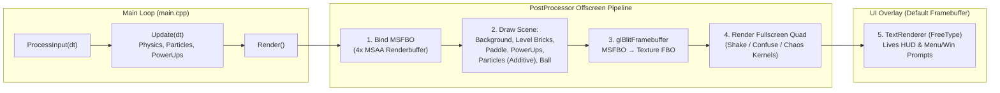

# Breakout — 2D Arcade Game in C++ & OpenGL 3.3


A complete 2D arcade **Breakout** game built from scratch in modern C++ and **OpenGL 3.3 Core Profile**, developed as the **Final Project** for a university **Game Development** course. Created step-by-step following Joey de Vries's [LearnOpenGL 2D Game: Breakout](https://learnopengl.com/In-Practice/2D-Game/Breakout) series, the project implements a custom 2D rendering engine featuring sprite batching/rendering, AABB & Circle–AABB physics, a 1,500-particle additive-blended emitter, 4x MSAA offscreen framebuffer post-processing shaders, FreeType TrueType glyph rendering, a 6-type power-up system, and irrKlang audio.

---

## Table of Contents

- [Overview](#overview)
- [Gameplay & Engine Features](#gameplay--engine-features)
- [Rendering Pipeline & Architecture](#rendering-pipeline--architecture)
- [Controls & Game States](#controls--game-states)
- [Power-Ups & Debuffs](#power-ups--debuffs)
- [Level Format & Built-In Levels](#level-format--built-in-levels)
- [Project Structure](#project-structure)
- [Dependencies & Setup](#dependencies--setup)
- [Building & Running](#building--running)
- [Acknowledgments & Credits](#acknowledgments--credits)
- [Author](#author)

---

## Overview

Rather than relying on a commercial game engine, this project constructs a modular 2D game architecture directly on top of **OpenGL 3.3**, **GLFW**, **GLAD**, **GLM**, **FreeType**, **stb_image**, and **irrKlang**. Every subsystem—shader compilation, texture management, orthographic sprite transformations, circle-vs-box collision resolution, particle pooling, multisampled framebuffer blitting, Convolution kernel post-processing, and glyph bitmap rasterization—is implemented in C++ and GLSL.

---

## Gameplay & Engine Features

- **Custom 2D Orthographic Sprite Renderer ([`SpriteRenderer`](Breakout/include/sprite_renderer.h))**
  - Renders textured 2D quads using an orthographic projection matrix (`600 x 800` viewport) with full support for translation, center-pivot rotation, scaling, and RGB color modulation (`shaders/sprite.vert`, `shaders/sprite.frag`).
- **Circle–AABB & AABB–AABB Collision Physics ([`Game::DoCollisions`](Breakout/src/game.cpp))**
  - Computes closest-point clamped half-extents between the circular ball (`BALL_RADIUS = 8.0f`) and axis-aligned brick/paddle bounding boxes.
  - Determines impact direction (`UP`, `RIGHT`, `DOWN`, `LEFT`) via cardinal compass dot-products (`VectorDirection`) and resolves penetration depth to prevent tunneling.
  - Dynamically adjusts horizontal ball reflection angle based on the hit offset from the paddle's center while preserving total velocity magnitude (`glm::normalize(Velocity) * glm::length(oldVelocity)`).
- **1,500-Particle Glow Emitter ([`ParticleGenerator`](Breakout/include/particle_generator.h))**
  - Renders a comet trail behind the ball using additive alpha blending (`glBlendFunc(GL_SRC_ALPHA, GL_ONE)`).
  - Uses a ring-buffered search index (`lastUsedParticle`) in `firstUnusedParticle()` to recycle dead particles in amortized $O(1)$ time without dynamic allocations during gameplay.
- **4x MSAA Offscreen Framebuffer & GLSL Post-Processing ([`PostProcessor`](Breakout/include/post_processor.h))**
  - Renders the entire scene into a **4x Multisampled Framebuffer Object (`MSFBO`)**, resolves it via `glBlitFramebuffer` into a texture-backed intermediate `FBO`, and draws a fullscreen quad through [`post_processing.vert`](Breakout/shaders/post_processing.vert) and [`post_processing.frag`](Breakout/shaders/post_processing.frag).
  - Supports three real-time shader effects: **Screen Shake** ($3 \times 3$ Gaussian blur kernel + oscillatory vertex offset), **Confuse** (RGB color inversion + flipped UV coordinates), and **Chaos** ($3 \times 3$ edge-detection convolution kernel + circular trigonometric UV swirling).
- **FreeType 2D Text Rendering ([`TextRenderer`](Breakout/include/text_renderer.h))**
  - Rasterizes the first 128 ASCII characters of `fonts/OCRAEXT.TTF` into single-channel `GL_RED` OpenGL textures and renders dynamic UI strings (`Lives`, `Level` selector, menu/win overlays) via `glBufferSubData`.
- **Centralized Resource Management ([`ResourceManager`](Breakout/include/resource_manager.h))**
  - Static registry caching compiled [`Shader`](Breakout/include/shader.h) programs and [`Texture2D`](Breakout/include/texture.h) assets (`stb_image`) in `std::map` lookup tables with deterministic GPU memory cleanup.
- **2D Sound Engine Integration (`irrKlang`)**
  - Plays looping background music (`audio/breakout.mp3`) and distinct sound effects for destructible brick hits (`bleep.mp3`), solid brick impacts (`solid.wav`), paddle bounces (`bleep.wav`), and power-up activations (`powerup.wav`).

---

## Rendering Pipeline & Architecture



---

## Controls & Game States

The game operates across three states defined in `enum GameState` (`GAME_MENU`, `GAME_ACTIVE`, `GAME_WIN`):

| Key | State | Action |
| :---: | :---: | :--- |
| `A` / `D` | `GAME_MENU` | Cycle backward / forward through available levels (`Level 1` – `Level 4`) |
| `ENTER` | `GAME_MENU` | Start the selected level (`State -> GAME_ACTIVE`) |
| `A` / `D` | `GAME_ACTIVE` | Move the player paddle left / right (`500 px/s`) |
| `SPACE` | `GAME_ACTIVE` | Release the ball from the paddle (at start of life or during **Sticky** power-up) |
| `ENTER` | `GAME_WIN` | Disable **Chaos** effect and return to `GAME_MENU` |
| `ESC` | Any | Close the game window and exit |

---

## Power-Ups & Debuffs

Destroying a non-solid brick triggers [`Game::SpawnPowerUps`](Breakout/src/game.cpp), which rolls independent spawn probabilities for **4 positive buffs** (`1 in 75` chance each) and **2 negative debuffs** (`1 in 25` chance each). Collecting multiple power-ups of the same type extends the active duration (`IsOtherPowerUpActive`).

| Power-Up | Type | Texture | Spawn Chance | Duration | Effect |
| :--- | :---: | :--- | :---: | :---: | :--- |
| **Speed** | Positive | `powerup_speed.png` | `1 / 75` | Instant | Multiplies ball velocity by `1.2x`. |
| **Sticky** | Positive | `powerup_sticky.png` | `1 / 75` | `20.0s` | Tints paddle purple; ball sticks to the paddle on impact until `SPACE` is pressed. |
| **Pass-Through** | Positive | `powerup_passthrough.png` | `1 / 75` | `10.0s` | Tints ball pink; ball destroys non-solid bricks without bouncing off them. |
| **Pad-Size-Increase** | Positive | `powerup_increase.png` | `1 / 75` | Instant | Increases paddle width (`Player->Size.x`) by `+50 px`. |
| **Confuse** | Negative | `powerup_confuse.png` | `1 / 25` | `10.0s` | Activates `Effects->Confuse`: inverts screen colors and flips horizontal/vertical UVs. |
| **Chaos** | Negative | `powerup_chaos.png` | `1 / 25` | `10.0s` | Activates `Effects->Chaos`: applies $3 \times 3$ edge-detection kernel and circular UV motion. |

---

## Level Format & Built-In Levels

Levels are stored as plain-text 2D integer matrices in [`Breakout/levels/`](Breakout/levels/) and loaded dynamically at startup via `std::filesystem::directory_iterator("levels")`.

### Tile Code Legend
- `0` — Empty space (no brick)
- `1` — **Indestructible Solid Brick** (`block_solid.png`, grey tint, triggers `0.05s` screen shake & `solid.wav` on impact)
- `2` — Destructible Brick (Blue — `rgb(0.2, 0.6, 1.0)`)
- `3` — Destructible Brick (Green — `rgb(0.0, 0.7, 0.0)`)
- `4` — Destructible Brick (Yellow — `rgb(0.8, 0.8, 0.4)`)
- `5` — Destructible Brick (Orange — `rgb(1.0, 0.5, 0.0)`)

### Included Levels
1. [`1.lvl`](Breakout/levels/1.lvl) — **Standard**: Classic layered horizontal rows with strategic solid blocks.
2. [`2.lvl`](Breakout/levels/2.lvl) — **A Few Small Gaps**: Fortified perimeter of solid blocks enclosing alternating brick pairs.
3. [`3.lvl`](Breakout/levels/3.lvl) — **Space Invader**: Pixel-art alien formation guarded by a central solid shield.
4. [`4.lvl`](Breakout/levels/4.lvl) — **Bounce Galore**: Dense checkerboard of solid and destructible tiles for rapid multi-bounces.

---

## Project Structure

```text
Breakout-OpenGL/
├── Breakout.slnx                               # Visual Studio Solution
├── .gitignore                                  # Git ignore rules
├── README.md                                   # Project documentation
│
└── Breakout/
    ├── Breakout.vcxproj                        # MSVC C++20 project configuration
    ├── Breakout.vcxproj.filters                # Visual Studio filters
    │
    ├── include/                                # Header files
    │   ├── ball_object.h                       # BallObject class (Radius, Stuck, Sticky, PassThrough)
    │   ├── game.h                              # Game class, GameState, Direction, Collision tuple
    │   ├── game_level.h                        # GameLevel tile parser & renderer
    │   ├── game_object.h                       # Base GameObject (Position, Size, Velocity, Color, Sprite)
    │   ├── particle_generator.h                # Particle struct & 1500-particle emitter class
    │   ├── post_processor.h                    # Multisampled FBO & post-processing effect manager
    │   ├── power_up.h                          # PowerUp class (Type, Duration, Activated)
    │   ├── resource_manager.h                  # Static Shader & Texture2D asset manager
    │   ├── shader.h                            # OpenGL GLSL program wrapper & uniform setters
    │   ├── sprite_renderer.h                   # 2D quad VAO/VBO & model matrix transformer
    │   ├── stb_image.h                         # Single-header image loader (PNG/JPG)
    │   ├── text_renderer.h                     # FreeType Character glyph map & text renderer
    │   └── texture.h                           # OpenGL 2D texture wrapper
    │
    ├── src/                                    # Implementation files
    │   ├── main.cpp                            # GLFW window setup, GLAD init, input callbacks & main loop
    │   ├── game.cpp                            # Game lifecycle, physics, collisions, power-ups & audio
    │   ├── ball_object.cpp                     # Ball movement, boundary reflection & reset logic
    │   ├── game_level.cpp                      # .lvl file parsing & brick grid initialization
    │   ├── game_object.cpp                     # Base GameObject draw routine
    │   ├── glad.c                              # GLAD OpenGL 3.3 Core loader implementation
    │   ├── particle_generator.cpp              # Particle spawning, alpha decay & additive draw
    │   ├── post_processor.cpp                  # MSFBO/FBO setup, 3x3 kernels & fullscreen blit
    │   ├── resource_manager.cpp                # File I/O for shaders and stbi_load for textures
    │   ├── shader.cpp                          # Shader compilation, linking & error diagnostics
    │   ├── sprite_renderer.cpp                 # Quad VBO setup & TRS transformation matrix math
    │   ├── stb_image.cpp                       # STB_IMAGE_IMPLEMENTATION definition
    │   ├── text_renderer.cpp                   # FreeType glyph bitmap loading & dynamic quad rendering
    │   └── texture.cpp                         # glTexImage2D & sampler parameter configuration
    │
    ├── shaders/                                # GLSL 330 Core Shaders
    │   ├── sprite.vert / sprite.frag           # 2D sprite transformation & tinted texture sampling
    │   ├── particle.vert / particle.frag       # Scaled particle offset & color blending
    │   ├── post_processing.vert / .frag        # Shake, Confuse & Chaos vertex/fragment kernels
    │   └── text_2d.vert / text_2d.frag         # Orthographic glyph quad & single-channel red alpha mask
    │
    ├── levels/                                 # Tilemap level definitions
    │   ├── 1.lvl                               # Level 1: Standard
    │   ├── 2.lvl                               # Level 2: A Few Small Gaps
    │   ├── 3.lvl                               # Level 3: Space Invader
    │   └── 4.lvl                               # Level 4: Bounce Galore
    │
    ├── textures/                               # Game sprites & UI textures
    │   ├── background.jpg                      # Fullscreen game background
    │   ├── ball.png                            # Ball sprite
    │   ├── block.png / block_solid.png         # Destructible & indestructible brick sprites
    │   ├── paddle.png                          # Player paddle sprite
    │   ├── particle.png                        # Particle glow texture
    │   └── powerup_*.png                       # 6 power-up icon textures (speed, sticky, etc.)
    │
    ├── audio/                                  # Music & sound effects
    │   ├── breakout.mp3                        # Background music track
    │   ├── bleep.mp3 / bleep.wav               # Brick & paddle impact sounds
    │   ├── powerup.wav                         # Power-up pickup sound
    │   └── solid.wav                           # Solid brick clang sound
    │
    └── fonts/                                  # TrueType fonts
        ├── OCRAEXT.TTF                         # Primary HUD & menu font
        └── Antonio-*.ttf                       # Bundled Antonio font family (Bold, Light, Regular)
```

---

## Dependencies & Setup

### Required Libraries
1. **OpenGL 3.3+** (`opengl32.lib` — included with Windows SDK)
2. **GLAD** (`glad.c` is already included in [`Breakout/src/glad.c`](Breakout/src/glad.c); ensure GLAD headers `<glad/glad.h>` and `<KHR/khrplatform.h>` are in your include path)
3. **GLFW 3** (`glfw3.lib` and `<GLFW/glfw3.h>`) — [https://www.glfw.org/](https://www.glfw.org/)
4. **GLM (OpenGL Mathematics)** (header-only `<glm/glm.hpp>`) — [https://github.com/g-truc/glm](https://github.com/g-truc/glm)
5. **FreeType 2** (`freetype.lib` and `<ft2build.h>`) — [https://freetype.org/](https://freetype.org/)
6. **irrKlang Audio Library** (`irrKlang.lib`, `<irrKlang.h>`, `irrKlang.dll`, `ikpMP3.dll`) — [https://www.ambiera.com/irrklang/](https://www.ambiera.com/irrklang/) (or [https://github.com/jonas2602/irrKlang](https://github.com/jonas2602/irrKlang))
7. **stb_image** (already bundled in [`Breakout/include/stb_image.h`](Breakout/include/stb_image.h))

---

## Building & Running

1. **Clone the repository:**
   ```bash
   git clone https://github.com/DavitBakh/Breakout-OpenGL.git
   cd Breakout-OpenGL
   ```
2. **Open the Solution in Visual Studio:**
   - Open `Breakout.slnx` (or `Breakout/Breakout.vcxproj`) in **Visual Studio 2022** (or newer).
3. **Configure Include & Library Paths:**
   - In **Project Properties -> C/C++ -> General -> Additional Include Directories**, point to your local `GLAD/include`, `GLFW/include`, `glm`, `FreeType/include`, and `irrKlang/include` folders (or install them via `vcpkg integrate install`).
   - In **Project Properties -> Linker -> General -> Additional Library Directories**, point to your `GLFW`, `FreeType`, and `irrKlang` `.lib` directories.
   - In **Project Properties -> Linker -> Input -> Additional Dependencies**, ensure `glfw3.lib;opengl32.lib;irrKlang.lib;freetype.lib;` are linked.
4. **Copy Runtime Audio DLLs:**
   - Place `irrKlang.dll` and `ikpMP3.dll` (for MP3 decoding) in the executable output directory (or inside `Breakout/` when running from the Visual Studio debugger).
5. **Build and Run:**
   - Select **Debug / x64** or **Release / x64**, build (`Ctrl + Shift + B`), and launch (`Ctrl + F5`).

---

## Acknowledgments & Credits

- **Tutorial & Architecture**: Joey de Vries — [LearnOpenGL: 2D Game — Breakout](https://learnopengl.com/In-Practice/2D-Game/Breakout)

---

## Author

- **Davit Bakhshyan** — [@DavitBakh](https://github.com/DavitBakh)
